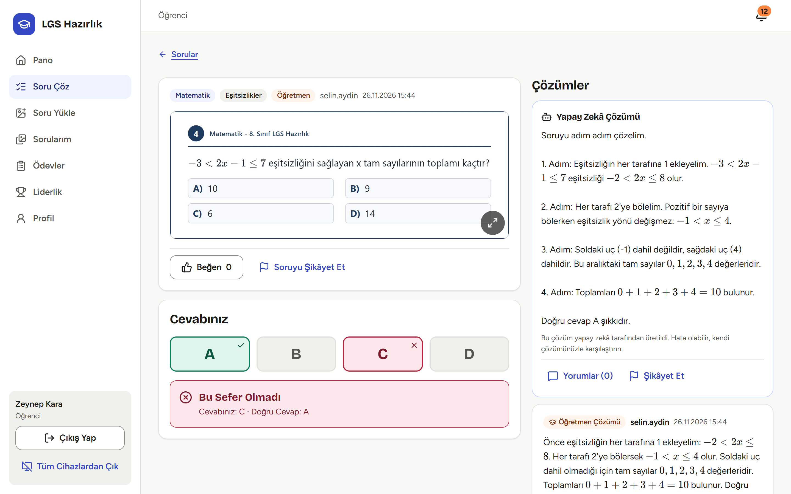
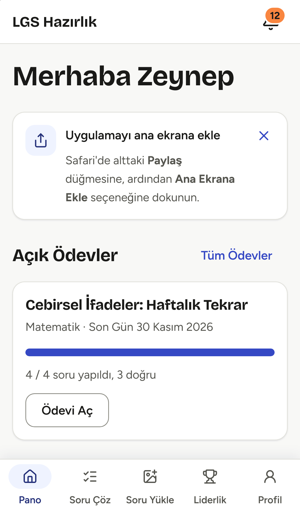
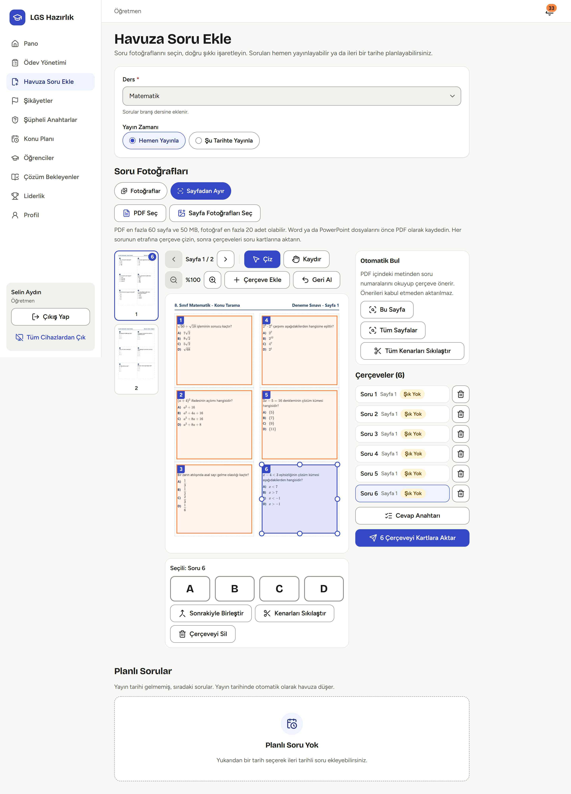

# netpesinde.com

Bu proje, LGS sürecindeki öğrencilerin soru çözümünü teşvik etmek ve gelişimlerini takip etmek amacıyla planlanmıştır. Projenin yayına çıkan ilk hali [skose241/LGSApp](https://github.com/skose241/LGSApp) olup bu repoda 2. versiyonu çıkarılmıştır.

Proje şu anda [netpesinde.com](https://netpesinde.com) adresi üzerinden yayındadır.

## Ekran Görüntüleri

Görüntüler, kurgusal verilerle hazırlanan yerel demo ortamından alınmıştır.

<p align="center">
  
</p>
<p align="center"><em>Öğrenci: soru detayı, cevap sonucu ve yapay zekâ çözümü</em></p>

<table>
  <tr>
    <td align="center" width="35%"></td>
    <td align="center" width="65%"></td>
  </tr>
  <tr>
    <td align="center"><em>Öğrenci panosu (iPhone)</em></td>
    <td align="center"><em>Öğretmen: PDF sayfasından soru kırpma</em></td>
  </tr>
</table>

---

## İçindekiler

- [Ekran Görüntüleri](#ekran-görüntüleri)
- [Projenin Özelliği](#projenin-özelliği)
- [Roller](#roller)
- [Projenin İşleyişi](#projenin-i̇şleyişi)
- [Puan Sistemi ve Liderlik Tablosu](#puan-sistemi-ve-liderlik-tablosu)
- [Günlük Görevler](#günlük-görevler)
- [Önceki Versiyondan Farkları](#önceki-versiyondan-farkları)
- [Proje Süreci](#proje-süreci)
- [Yararlanılan Teknolojiler](#yararlanılan-teknolojiler)
- [Klasör Yapısı](#klasör-yapısı)
- [Yerelde Çalıştırma](#yerelde-çalıştırma)
- [Lisanslar](#lisanslar)

---

## Projenin Özelliği

- Bu projeye dışarıdan kayıt bulunmamaktadır. İçerisindeki hesaplar, sistem veya müdür tarafından tanımlanmakta ve bu sayede okul-dershane gibi sadece bir kurumun kontrolünde tutulmaktadır.
- Hesaplarda e-posta adresi kullanılmamaktadır. Her kullanıcıya müdür tarafından tek seferlik şifre verilir; kullanıcı ilk girişte kendi şifresini belirler. Şifresini unutan kullanıcı talep oluşturur, müdür onayı ile yeni tek seferlik şifre verilir.
- İçerisinde bulunan yapay zekâ sayesinde hem öğrencilerin sorularına çözüm üretilebilmekte hem de öğretmenlerin belirlediği konulara göre günlük olarak soru üretilebilmektedir.
- Önceki versiyonda yaşanan HEIC türü (iPhone) fotoğrafların sisteme yüklenememesi sorunu, açık kaynak lisanslarında belirtildiği üzere `heic-to` kütüphanesi yardımı ile çözülmüştür.
- Ödev modülünde sadece fotoğraf değil PDF üzerinden de soru yükleyebilme eklentisi sayesinde önceki versiyondan ayrışmaktadır. Öğretmenler, yükledikleri PDF kaynağının istedikleri sayfasından istedikleri soruları kırparak sisteme yükleyebilmektedir. Bu kırpma ister elle ister sistem aracılığı ile yapılabilmektedir.

## Roller

| Rol | Kod | Yetkiler |
| --- | --- | --- |
| **Müdür** | 1 | Hesap oluşturur, tek seferlik şifre verir, şifre sıfırlama taleplerini onaylar. Görev zamanlayıcısının çalışmadığı günlerde soru üretme / soru yayınlama / ödev kapatma işlemlerini elle başlatabilir. Şikâyet edilen kullanıcıları yasaklayabilir. Öğretmen ve öğrencilerin tüm adımlarını görüntüleyebilir. |
| **Öğretmen** | 2 | Ödev yükler, ödeve tarih atar, ileriye yönelik ödev planlar. Öğrenci profillerini inceler; hangi dersten kaç soru çözüldüğünü, ödevlere katılımı ve doğru/yanlış durumunu görür. Şikâyet edilen soruları inceler ve doğru cevabı değiştirebilir. Branşına göre yapay zekânın soru üreteceği konuyu seçer. |
| **Öğrenci** | 3 | Soru yükler, sistemdeki soruları çözer, sorular altında ağaç yapısında tartışmaya katılır, hatalı olduğunu düşündüğü soruları şikâyet eder. |
| **Yapay Zekâ** | 4 | Her gün belirlenen derslerden belirlenen sayıda soru üretir ve öğrencinin istediği sorularda çözüm yapar. |

Müdür hesabı sistemin kilit hesabıdır. Proje sahibinin de "Müdür" olarak tanımlanmasından ötürü tüm işlemleri görüntüleyebilmesi ve yaşanan sorunlarda daha tutarlı bir işlem yapabilmesi amaçlanmıştır.

## Projenin İşleyişi

### Öğrenci

- Öğrenciler, çözemedikleri veya beğendikleri soruları sisteme fotoğraf aracılığıyla yüklerler ve yükleme başına puan alırlar.
- Soru yüklerken açıklama zorunluluğu bulunmaktadır. Bu şart ile öğrencinin soruyu çözerken nerede takıldığını, yani kendi hatasını ifade edebilmesi amaçlanmıştır.
- Öğrenciler kendi yükledikleri soru üzerinden çözüm puanı elde edemezler. Çözdükleri doğru soru başına ayrı puan almaktadırlar.
- Çözümde de açıklama şarttır. Açıklama metin veya fotoğraf olarak verilebilir. Bu sayede öğrencinin soruyu sadece çözmesi değil çözüm aşamalarını anlatabilmesi de amaçlanmıştır.
- Öğrenciler her soru altında ağaç yapısında yorumlaşabilir, hatalı olduğunu düşündükleri soruları şikâyet edebilirler.

### Öğretmen

- Öğretmenler sistemde tanımlanan araçlar sayesinde ödev yükleyebilir, buna başlangıç ve bitiş tarihi atayabilirler.
- Öğretmenler için ayrıca bir **havuz** bulunmaktadır. Bu sayede gördükleri bir soruyu sistemde kaydederek sonradan kullanma hakları vardır. Havuz, dışarıdan görüntülemeye kapalıdır; sadece ilgili öğretmen ve müdür hesapları görebilir.
- Ödevler, girilen tarih sonucunda kapandıktan sonra öğrenci etkileşimine açılır. Sorulara itiraz etmek veya çözemediği soruyu sormak için ödevin kapanması beklenmelidir.
- Her öğretmen, branşı ile ilgili üretilecek dersler için en geç **16.45**'e kadar konu seçimi yapmalıdır. Bu sayede yapay zekâ, üreteceği sorular için derste işlenen güncel konuyu takip edebilir.
- Öğretmenler öğrenci profili üzerinden öğrencinin yüklediği soruları, takıldığı yerleri ve verdiği cevapları açıklamaları ile birlikte inceleyebilir.

### Müdür

- Yeni hesap oluşturabilir, şifresini unutan hesaplara tek seferlik şifre verebilir.
- Zamanlayıcının çalışmadığı durumlarda günlük görevleri yönetim panelinden elle tetikleyebilir.
- Öğrenci, ödev ve soru havuzu ekranlarının tamamını görüntüleyebilir.

## Puan Sistemi ve Liderlik Tablosu

Öğrencilerin katılımı puan ile takip edilmektedir. Varsayılan değerler şu şekildedir:

| İşlem | Puan |
| --- | --- |
| Soru yükleme (açıklamalı) | 3 |
| Doğru cevap | 5 |
| Çözüm açıklaması yazma | 5 |

- Puan kazandıran soru yükleme sayısı günde 5 ile sınırlandırılmıştır. Bu sayede puan için rastgele soru yüklenmesinin önüne geçilmesi amaçlanmıştır.
- Haftalık ve aylık liderlik tablosu bulunmaktadır.

## Günlük Görevler

Saatler Türkiye saatine göredir.

| Saat | Görev | Açıklama |
| --- | --- | --- |
| 16.45 | Konu seçimi son saati | Öğretmenler üretilecek soruların konusunu bu saate kadar seçer. |
| 17.30 | Günlük soru üretimi | Yapay zekâ, seçilen konulara göre istenen sayıda soru üretir. |
| 18.15 | Günlük soru tamamlama | Üretim sırasında hata alınan sorular tekrar oluşturulur ve günlük hedef tamamlanır. |
| 19.00 | Günlük soru yayınlama | Üretilen sorular yayına alınır. |
| 00.05 | Ödev kontrolü | Süresi dolan ödevler kapatılır ve öğrenci etkileşimine açılır. |

## Önceki Versiyondan Farkları

| Konu | 1. Versiyon | 2. Versiyon |
| --- | --- | --- |
| Teknoloji | CFML / Lucee / MSSQL | ASP.NET Core / Next.js / Azure SQL |
| Barındırma | Sanal sunucu | Microsoft Azure (bulut) |
| iPhone fotoğrafları | HEIC dosyaları ve toplu yükleme başarısız | `heic-to` ile tarayıcıda dönüştürme |
| Ödev yükleme | Sadece fotoğraf | Fotoğraf + PDF kırpma (elle veya otomatik) |
| Görev zamanlayıcısı | "Yetkisiz erişim" hatası ile tetiklenemiyordu | Uygulama içi zamanlayıcı + müdür panelinden elle tetikleme |
| Yapay zekâ | — | Gemini API ile soru üretimi ve çözüm |

## Proje Süreci

- Bu proje aynı zamanda multi-agent sistemini tanımak amacıyla planlanmıştır. VS Code üzerinde Claude Code kullanılarak tasarlanmıştır.
- Önceki versiyona büyük oranda bağlı kalarak tasarlanan bu proje için; önceden karşılaşılan problemlerin çözüm yolları ve kullanım kolaylığı için geliştirilebilecek alternatif şemalar araştırılmış, teknoloji transferi de bu araştırmaya göre gerçekleştirilmiştir.
- Agent'ların rol ayrımının yapılması, referans alınacak şablonun ([skose241/LGSApp](https://github.com/skose241/LGSApp)) paylaşılması ve istenen tüm özelliklerin raporunun verilmesi ile proje yazımına başlanmıştır.
- Kullanılan agent'lar ve görevleri:
  - **backend-agent:** API, Azure SQL ve yapay zekâ servisi katmanı
  - **frontend-agent:** React / Next.js arayüz katmanı
  - **reviewer-agent:** Kod sonrası test ve tutarlılık kontrolü
  - **Plan agent:** Mimarisi netleşmemiş konularda planlama
- Her çalışma oturumunun sonunda yapılanlar, alınan kararlar ve sıradaki adımlar oturum notlarına işlenmiş; bir sonraki oturum bu notlardan devam ettirilmiştir.
- Sanal sunucudan bulut tabana geçilerek mevcut alan adı üzerinde ayarlamalar yapılmış ve her bir süreç detaylıca araştırılmıştır.

## Yararlanılan Teknolojiler

### Backend

- ASP.NET Core (.NET 10), Entity Framework Core, ASP.NET Core Identity, JWT kimlik doğrulama
- Scalar (API dokümantasyonu), SkiaSharp (görsel işleme)

### Frontend

- Next.js 16, React 19, TypeScript
- Tailwind CSS, Radix UI, TanStack Query, React Hook Form, Zod
- `heic-to` (HEIC dönüştürme), `pdfjs-dist` (PDF kırpma), KaTeX (matematik ifadeleri)

### Veritabanı ve Depolama

- Azure SQL Database
- Azure Blob Storage (soru ve çözüm görselleri)

### Yapay Zekâ

- Google Gemini API (kendi `IGeminiClient` arayüzü üzerinden doğrudan REST)

### Altyapı ve Dağıtım

- Microsoft Azure App Service, Key Vault, Application Insights
- Bicep (altyapının kod olarak tanımlanması)
- GitHub Actions (CI ve dağıtım)

### Test

- xUnit (backend), Vitest (frontend birim), Playwright + axe (uçtan uca ve erişilebilirlik)

## Klasör Yapısı

```text
LGSApp-v2/
├── backend/        ASP.NET Core API, domain, altyapı katmanları ve testler
├── frontend/       Next.js uygulaması (apps/web) ve API istemci paketi (packages/api)
├── contracts/      OpenAPI sözleşmesi
├── infra/          Azure Bicep şablonları
└── scripts/        Dağıtım betikleri
```

## Yerelde Çalıştırma

Gereksinimler: .NET 10 SDK, Node.js 22+, pnpm, SQL Server LocalDB

```bash
# Backend
dotnet run --project backend/src/LGSApp.Api

# Frontend
cd frontend
pnpm install
pnpm dev

# Örnek verili demo ortamı (ayrı veritabanı, sahte yapay zekâ)
pnpm --filter @lgs/web demo:run

# Testler
dotnet test backend/LGSApp.slnx
pnpm test
```

## Lisanslar

Projede kullanılan açık kaynak kütüphanelerin lisansları uygulama içindeki **Lisanslar** sayfasında listelenmektedir.
